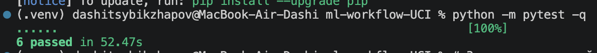
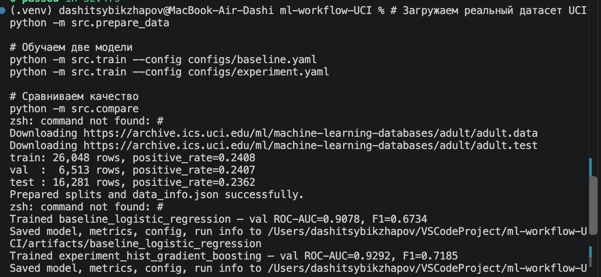
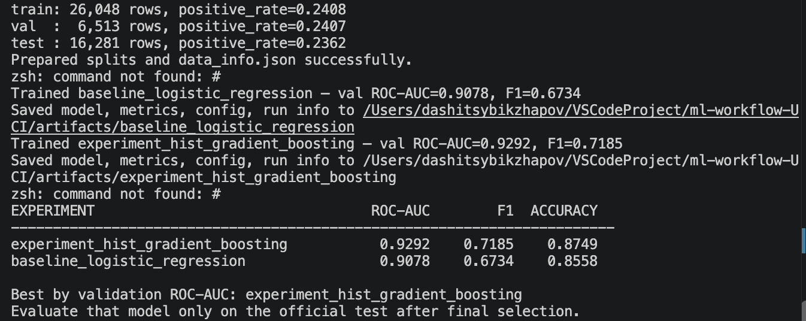
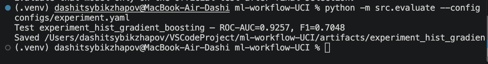

# Отчёт по HW-1

## Что сделано
Создан воспроизводимый ML-проект на датасете UCI Adult для прогноза дохода выше $50 000. Код разделён на независимые этапы:

1. Загрузка данных и создание train/validation/official test.
2. Обучение двух моделей по отдельным YAML-конфигурациям: Logistic Regression и HistGradientBoosting.
3. Сравнение моделей по ROC-AUC на validation.
4. Отдельная финальная оценка выбранной модели на официальном test.
5. Сохранение модели, параметров, метрик, версий библиотек и контрольных сумм данных.

Добавлены requirements.txt, requirements-dev.txt, .gitignore, README.md и автоматические тесты. 

## Результаты
Проверка кода: 6 автоматических тестов пройдены (6 passed).

Разбиение: train - 26 048, validation - 6 513, official test - 16 281 наблюдение.

| Модель | Val ROC-AUC | Val F1 | Val Accuracy |
| --- | ---: | ---: | ---: |
| Logistic Regression | 0.9078 | 0.6734 | 0.8558 |
| **HistGradientBoosting** | **0.9292** | **0.7185** | **0.8749** |

HistGradientBoosting выбран по максимальному validation ROC-AUC. Прирост относительно Logistic Regression — +0.0214 ROC-AUC (2.14 п.п.).

Результат на независимом тестовой выборке:
| Метрика | Значение |
| --- | ---: |
| ROC-AUC | **0.925723** |
| F1 | 0.704783 |
| Accuracy | 0.871875 |
| Precision | 0.773292 |
| Recall | 0.647426 |
| Log loss | 0.279811 |

## Проверка воспроизводимости
Из папки HW-1 после установки зависимостей:
```bash
python -m pytest -q
python -m src.prepare_data
python -m src.train --config configs/baseline.yaml
python -m src.train --config configs/experiment.yaml
python -m src.compare
python -m src.evaluate --config configs/experiment.yaml
```
Данные UCI скачиваются автоматически. Обученные модели и метрики создаются локально в HW-1/artifacts/; в Git они не загружаются.

>Примечание: результаты получены до переноса исходных файлов в HW-1; после изменения структуры команды нужно повторно проверить из новой папки. Это не меняет полученные метрики, но подтверждает корректность новой организации проекта.

## Скриншоты работы

Скриншот 1 - успешный запуск тестов (6 passed):


Скриншот 2 - обучение обеих моделей и сравнение ROC-AUC:



Скриншот 3 - оценка лучшей модели на официальном test:


## Вывод
В результате получен воспроизводимый ML-workflow,то есть: данные подготавливаются командой, параметры вынесены в YAML, модели сравниваются по независимой валидации, финальный тест не используется при выборе алгоритма, а результаты сохраняются в машиночитаемом формате.